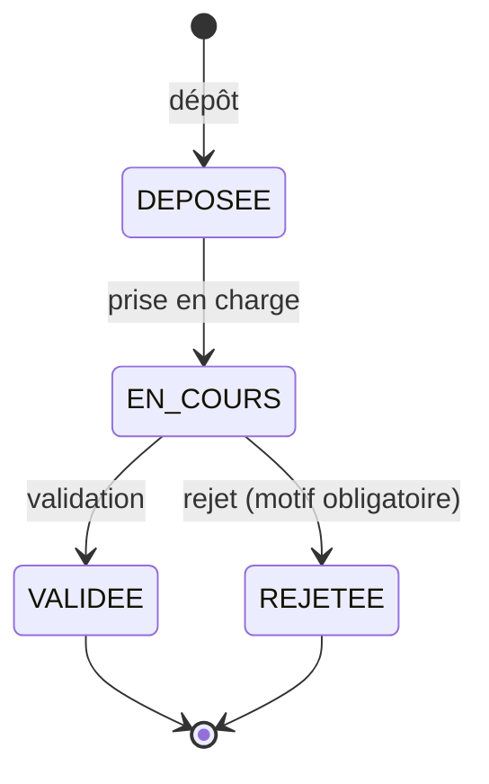

# Suivi des demandes d'actes — API

API REST de gestion des demandes d'actes administratifs (acte de naissance, casier judiciaire, certificat de résidence) : un usager dépose une demande, un agent la fait avancer jusqu'à sa validation ou son rejet.

Réalisée dans le cadre de l'étude de cas **DEP/ASIN 2026** (développeur(se) junior(e)).

**Stack** : Node.js · TypeScript · Express 5 · SQLite (intégré à Node) · Zod · tests avec `node:test`.

---

## 1. Démarrage

### Prérequis
- **Node.js ≥ 22.13** (développé et testé avec Node 24).
- Rien d'autre : **aucune base de données à installer** (SQLite est intégré à Node ; le fichier `data/demandes.db` est créé automatiquement).

### Installation et lancement

```bash
npm install
npm start
```

Une fois lancée, l'application répond sur **http://localhost:3000** :

| Adresse | Contenu |
|---|---|
| http://localhost:3000 | Écran de consultation des demandes d'un usager |
| http://localhost:3000/health | Vérification que l'API répond |

### Commandes utiles

| Commande | Effet |
|---|---|
| `npm start` | Démarre l'API et l'écran |
| `npm run seed` | *(facultatif)* Crée 25 demandes de démonstration pour le NPI `0123456789` (pagination, filtres, statuts variés) |
| `npm test` | Lance les 60 tests automatisés |
| `npm run typecheck` | Vérifie les types TypeScript |
| `npm run dev` | Démarre avec rechargement automatique |

### Changer le port ou le fichier de base

| Terminal | Commande |
|---|---|
| Bash / Git Bash / macOS / Linux | `PORT=4000 npm start` |
| PowerShell | `$env:PORT=4000; npm start` |
| Invite de commandes (cmd) | `set PORT=4000 && npm start` |

Variables : `PORT` (défaut `3000`) et `DATABASE_FILE` (défaut `data/demandes.db`). Pour repartir d'une base vierge, supprimer le dossier `data/`.

---

## 2. Scénario de recette

### Via l'écran
1. `npm run seed`, puis `npm start`.
2. Ouvrir http://localhost:3000, saisir le NPI `0123456789` : la liste s'affiche (20 par page, de la plus récente à la plus ancienne), avec le nombre de demandes par statut.
3. Tester le filtre par statut, la pagination et un NPI invalide (message d'erreur clair).

### Via l'API
Les requêtes ci-dessous sont aussi dans le fichier [`requests.http`](requests.http) (extension *REST Client* de VS Code, ou Postman).

```bash
# 1. Déposer une demande → 201, statut DEPOSEE
curl -i -X POST http://localhost:3000/demandes -H "Content-Type: application/json" \
  -d '{"npi":"0123456789","typeActe":"ACTE_NAISSANCE","nombreCopies":2}'

# 2. Consulter les demandes d'un usager (récent d'abord), avec filtre facultatif
curl "http://localhost:3000/usagers/0123456789/demandes"
curl "http://localhost:3000/usagers/0123456789/demandes?statut=DEPOSEE&page=1"

# 3. Faire avancer la demande n°1
curl -X PATCH http://localhost:3000/demandes/1/statut -H "Content-Type: application/json" -d '{"statut":"EN_COURS"}'
curl -X PATCH http://localhost:3000/demandes/1/statut -H "Content-Type: application/json" -d '{"statut":"REJETEE","motifRejet":"Pièce justificative illisible"}'

# 4. Cas refusés (message clair)
curl -X PATCH http://localhost:3000/demandes/1/statut -H "Content-Type: application/json" -d '{"statut":"EN_COURS"}'   # 409 : statut final
curl -X POST http://localhost:3000/demandes -H "Content-Type: application/json" -d '{"npi":"123","typeActe":"X","nombreCopies":9}'  # 400

# Bonus : nombre de demandes par statut
curl "http://localhost:3000/demandes/statistiques"
curl "http://localhost:3000/demandes/statistiques?npi=0123456789"
```

> **PowerShell** : `curl` y est un alias de `Invoke-WebRequest`. Utiliser `curl.exe`, ou `Invoke-RestMethod`, ou le fichier `requests.http`.
> Exemple : `Invoke-RestMethod http://localhost:3000/usagers/0123456789/demandes`

---

## 3. L'API

### Cycle de vie d'une demande



`VALIDEE` et `REJETEE` sont des **statuts finaux** : la demande ne change plus. On ne peut ni sauter une étape (déposée → validée) ni reculer.

### Routes

| Méthode | Route | Rôle | Succès | Erreurs |
|---|---|---|---|---|
| `POST` | `/demandes` | Déposer une demande | `201` + en-tête `Location` | `400` |
| `GET` | `/usagers/{npi}/demandes` | Demandes d'un usager (récent → ancien). Paramètres : `statut`, `page`, `taille` | `200` | `400` |
| `PATCH` | `/demandes/{id}/statut` | Faire avancer une demande | `200` | `400`, `404`, `409` |
| `GET` | `/demandes/{id}` | Détail d'une demande | `200` | `400`, `404` |
| `GET` | `/demandes/statistiques` | Nombre de demandes par statut (paramètre facultatif `npi`) | `200` | `400` |
| `GET` | `/referentiels` | Types d'acte, statuts, transitions autorisées | `200` | |
| `GET` | `/health` | Santé de l'API | `200` | |

### Valeurs

| Champ | Valeurs |
|---|---|
| `typeActe` | `ACTE_NAISSANCE`, `CASIER_JUDICIAIRE`, `CERTIFICAT_RESIDENCE` |
| `statut` | `DEPOSEE`, `EN_COURS`, `VALIDEE`, `REJETEE` |

### Exemples

**Déposer** — `POST /demandes`
```json
{ "npi": "0123456789", "typeActe": "ACTE_NAISSANCE", "nombreCopies": 2 }
```
Réponse `201` :
```json
{
  "id": 1, "npi": "0123456789", "typeActe": "ACTE_NAISSANCE", "nombreCopies": 2,
  "statut": "DEPOSEE", "motifRejet": null,
  "creeLe": "2026-10-06T10:00:00.000Z", "modifieLe": "2026-10-06T10:00:00.000Z"
}
```

**Faire avancer** — `PATCH /demandes/1/statut`
```json
{ "statut": "REJETEE", "motifRejet": "Pièce justificative illisible" }
```

**Lister** — `GET /usagers/0123456789/demandes?statut=EN_COURS&page=1&taille=20`
```json
{
  "data": [ { "id": 12, "...": "..." } ],
  "pagination": { "page": 1, "taille": 20, "total": 7, "totalPages": 1 }
}
```

**Statistiques** — `GET /demandes/statistiques`
```json
{ "total": 25, "parStatut": { "DEPOSEE": 7, "EN_COURS": 6, "VALIDEE": 6, "REJETEE": 6 } }
```

### Règles de gestion et réponses

| Règle | Si elle n'est pas respectée |
|---|---|
| NPI : exactement 10 chiffres (chaîne de caractères, pour conserver les zéros initiaux) | `400` |
| Type d'acte : l'un des trois types | `400` |
| Nombre de copies : entier entre 1 et 5 | `400` |
| Un rejet doit toujours être motivé (`motifRejet` non vide, 500 caractères max) | `400` |
| Transition interdite (saut d'étape, retour en arrière, statut final) | `409` |
| Demande inconnue | `404` |
| Pagination : 20 demandes par page au maximum | `taille` supérieure à 20 ramenée à 20 ; `page` ou `taille` < 1 : `400` |

### Format des erreurs
Toutes les erreurs ont la même forme, avec un message lisible par l'utilisateur :

```json
{
  "error": {
    "code": "VALIDATION_ERROR",
    "message": "Le NPI doit comporter exactement 10 chiffres.",
    "details": [ { "champ": "npi", "message": "Le NPI doit comporter exactement 10 chiffres." } ]
  }
}
```

Exemple d'action interdite (`409`) :
> *La demande n°1 est déjà « Rejetée » (REJETEE) : elle ne peut plus changer de statut.*

### Hypothèses prises
- Un usager n'est identifié que par son NPI (pas de compte) : un NPI valide sans demande renvoie une liste vide (`200`).
- Le `motifRejet` envoyé avec un statut autre que `REJETEE` est ignoré.
- Le statut initial est toujours `DEPOSEE` : il ne peut pas être choisi au dépôt.

---

## 4. Conception

### Organisation du code

```
src/
├── domain/                     # Cœur métier, indépendant d'Express et de SQLite
│   ├── demande.ts              #   Types, constantes, cycle de vie (source unique de vérité)
│   ├── rules.ts                #   Règles de validation des saisies (Zod)
│   ├── demande.service.ts      #   Cas d'usage : déposer, lister, changer de statut, statistiques
│   └── errors.ts               #   Erreurs métier (400 / 404 / 409)
├── infra/                      # Accès aux données
│   ├── database.ts             #   Ouverture SQLite + schéma
│   └── sqlite-demande.repository.ts
├── http/                       # Couche web
│   ├── routes.ts               #   Routes : valider → appeler le service → répondre
│   ├── app.ts                  #   Configuration Express
│   └── error-handler.ts        #   Format d'erreur unique
├── config.ts                   # Variables d'environnement
└── index.ts                    # Point d'entrée
public/index.html               # Écran de consultation (HTML + JS, sans étape de build)
tests/                          # Règles, service, API de bout en bout
```

### Modèle de données (table `demandes`)

| Colonne | Type | Contrainte |
|---|---|---|
| `id` | entier auto-incrémenté | clé primaire |
| `npi` | texte | exactement 10 chiffres |
| `type_acte` | texte | l'un des 3 types |
| `nombre_copies` | entier | entre 1 et 5 |
| `statut` | texte | l'un des 4 statuts, `DEPOSEE` par défaut |
| `motif_rejet` | texte, nul | renseigné **si et seulement si** `statut = REJETEE` |
| `cree_le`, `modifie_le` | date ISO 8601 | obligatoires |

Index sur `(npi, cree_le, id)` pour la liste d'un usager et sur `(npi, statut)` pour le filtre et les statistiques.

### Choix techniques
- **Séparation en couches** : les règles métier vivent dans `domain/`, testables sans serveur ni base. Les routes ne contiennent aucune logique.
- **Une seule source de vérité** : les statuts, types d'acte, limites et transitions sont déclarés une fois (`domain/demande.ts`). La validation, le schéma SQL, l'API (`/referentiels`) et l'écran en dérivent (principe DRY).
- **SQLite intégré à Node** : le jury lance l'application sans rien installer ni configurer. L'interface `DemandeRepository` isole le stockage : passer à PostgreSQL consiste à écrire une autre implémentation, sans toucher au service ni aux routes.
- **Défense en profondeur** : les règles sont validées par l'API (messages clairs) **et** par les contraintes `CHECK` de la base.
- **Sécurité** : requêtes SQL toujours paramétrées (pas d'injection), aucune trace d'erreur technique envoyée au client, taille du corps limitée, écran qui insère les données avec `textContent` (pas de faille XSS).
- **Codes HTTP sémantiques** : `201` + `Location` à la création, `400` saisie invalide, `404` ressource inconnue, `409` action interdite dans l'état courant.
- **Tri fiable** : la liste est triée par date de création décroissante, puis par `id` décroissant (départage deux dépôts à la même milliseconde).

### Tests
`npm test` exécute **60 tests** (sans dépendance externe, base SQLite en mémoire) :
- règles de gestion : NPI, type d'acte, copies, motif de rejet, cycle de vie, pagination ;
- service : dépôt, ordre de la liste, filtre, pagination, transitions, statistiques ;
- API de bout en bout : un vrai serveur HTTP et le scénario de recette complet.

---

## 5. État d'avancement

### Ce qui fonctionne
- ✅ **Socle** : dépôt d'une demande, consultation par usager (récent → ancien, filtre par statut), cycle de vie complet.
- ✅ **Toutes les règles de gestion**, avec messages d'erreur clairs.
- ✅ **Bonus 1** — Pagination (20 par page au maximum).
- ✅ **Bonus 2** — Nombre de demandes par statut (`/demandes/statistiques`, global ou par usager).
- ✅ **Bonus 3** — 60 tests automatisés des règles de gestion.
- ✅ **Bonus 4** — Écran simple de consultation des demandes d'un usager (`/`), avec filtre, pagination et statistiques.

### Ce qui manque, et pourquoi
- **Authentification et rôles (usager / agent)** : l'énoncé ne demande pas de gestion d'identité. Dans l'état actuel, n'importe quel client peut changer un statut ; en production, cette route serait réservée aux agents.
- **Historique des changements de statut** (qui, quand) : non demandé ; il dépend de l'identité de l'agent, absente ici.
- **Dépôt de demande depuis l'écran** : l'énoncé ne demande que l'affichage de la liste. Le dépôt se fait via l'API.
- **PostgreSQL / Docker** : SQLite suffit au périmètre et garantit un démarrage sans installation. La migration est prévue par l'architecture (`DemandeRepository`).
- **Verrouillage optimiste** (deux agents agissant en même temps) : inutile avec SQLite, qui traite les requêtes une par une ; nécessaire avec une base serveur.
- **Tests automatisés de l'écran** : il a été vérifié manuellement ; les règles et l'API sont, elles, couvertes par les tests.
